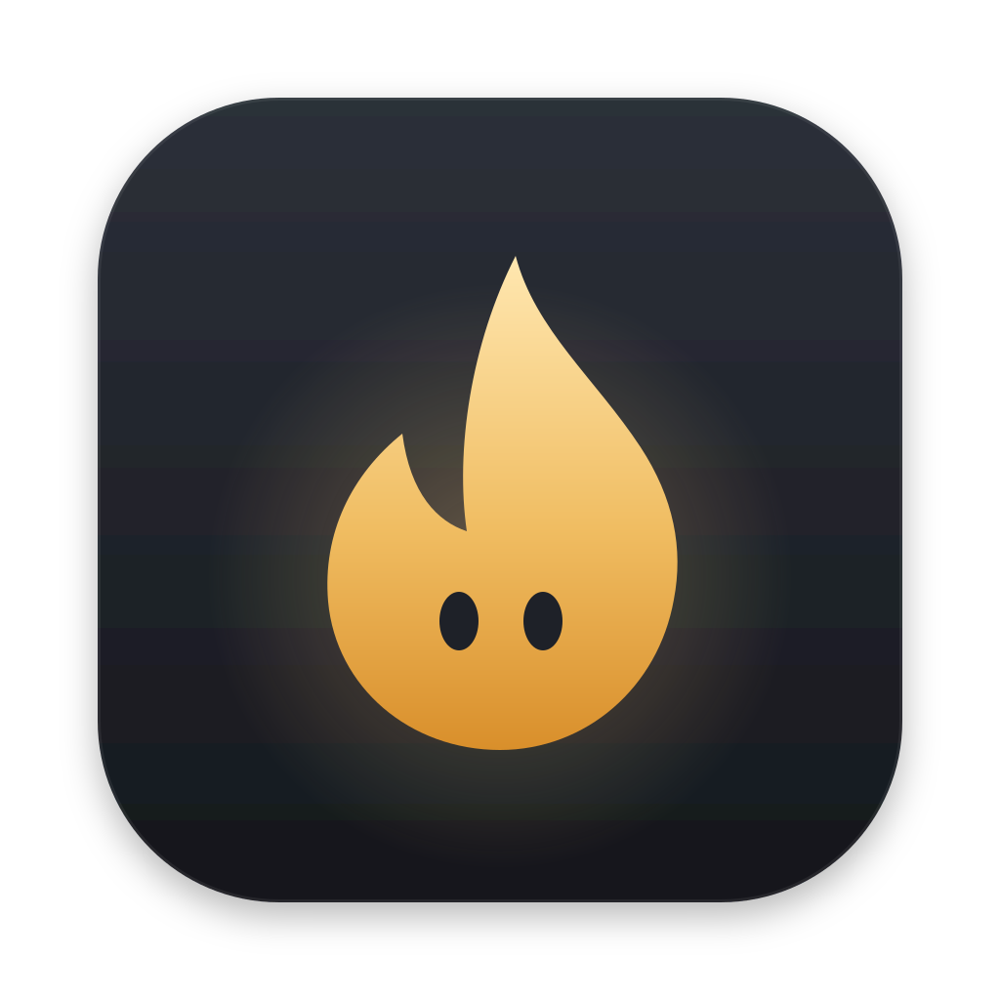
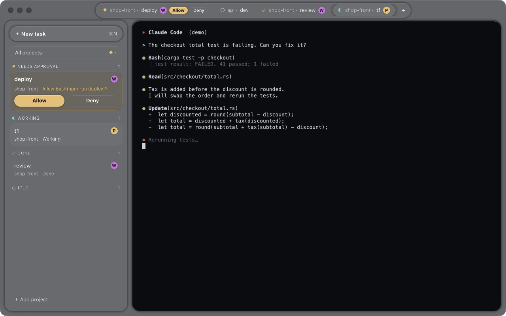
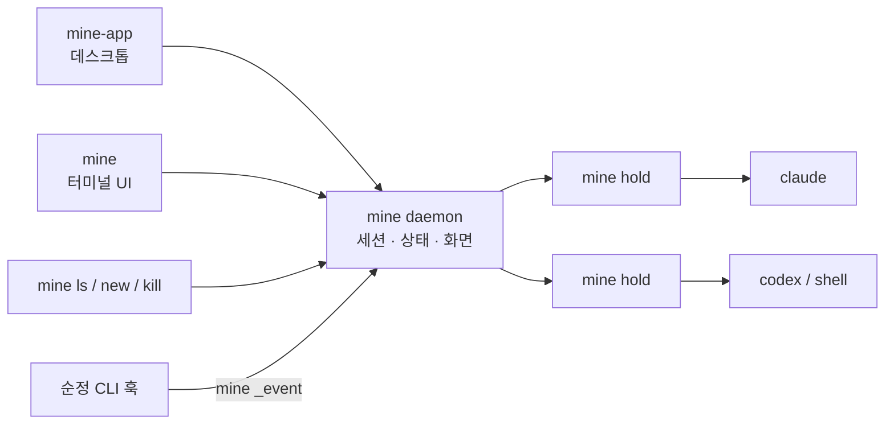

<div align="center">



# mine

**끊기지 않는 코딩 에이전트 세션.**

창, 계정, 머신, 연결이 바뀌어도 Claude Code와 Codex 세션은 계속 이어져요.

[설치](#설치) &nbsp;•&nbsp; [빠른 시작](#빠른-시작) &nbsp;•&nbsp; [동작 방식](#동작-방식) &nbsp;•&nbsp; [로드맵](#로드맵) &nbsp;•&nbsp; [English](README.md)



</div>

## 소개

에이전트 작업은 한 번에 끝나지 않아요. 리팩터링은 터미널 창보다 오래 가고, 계정 한도는 작업 중간에 바닥나고, 다른 머신에서 진행 상황을 보고 싶을 때도 있어요. 그때마다 잃는 건 세션, 그리고 그 안에 쌓인 맥락이에요.

mine은 세션을 주변의 모든 것보다 오래 사는 것으로 다뤄요. 작은 데몬이 Claude Code, Codex, 셸 세션을 모두 쥐고 있어요. 창과 SSH 연결이 오가도 세션은 그대로라서, 데스크톱 앱에서든 SSH 너머 터미널에서든, 나중에는 다른 계정과 다른 호스트에서도 하던 곳부터 이어 가요.

> [!NOTE]
> mine은 초기 단계이고 macOS(Apple Silicon)에서 한 사람의 작업 방식에 맞춰 만들고 있어요. 연결이 끊겨도 살아 있는 세션은 지금 동작하고, 계정 넘기기와 원격 호스트가 다음 차례예요. [로드맵](#로드맵)을 보세요.

## 특징

- **창보다 오래 사는 세션.** 세션마다 따로 뜨는 보관 프로세스가 PTY를 쥐어요. 앱을 닫거나 SSH가 끊기거나 데몬을 다시 띄워도 `claude`, `codex`, 개발 서버는 계속 돌아요. 다시 붙으면 화면이 돌아와요.
- **끝난 대화 이어 가기.** 프로세스가 끝난 Claude·Codex 세션은 목록에 *Exited*로 남아요. 고르면 같은 대화가 다시 시작돼요.
- **Claude 계정 두 개, 목록 하나.** 따로 로그인한 Claude 계정 두 개의 세션을 나란히 돌려요. 계정은 로그인 이름이나 직접 정한 별칭으로 보여요.
- **나를 기다리는 일부터.** 모든 프로젝트의 세션을 *Needs approval → Working → Done → Idle* 순서로 묶어요. 상태는 순정 CLI 훅으로 정해요.
- **키 하나로 시작.** 시작 화면에서 키 하나로 Claude, 두 번째 계정 Claude, Codex, 셸 세션을 만들어요.
- **순정 CLI 그대로.** 세션은 순정 Claude Code와 Codex를 띄워요. 키보드 모드(kitty 키보드, modifyOtherKeys)도 넘겨서 Shift+Enter가 그대로 동작해요.
- **데스크톱 앱과 터미널 UI.** 평소에는 GPUI 데스크톱 앱, SSH에서는 터미널 UI를 써요. 둘 다 같은 데몬에 붙어요.

## 설치

macOS와 Rust 1.89 이상이 필요해요. 쓰려는 에이전트 CLI(`claude`, `codex`)는 따로 설치하고 로그인해 두세요.

```sh
git clone https://github.com/oyobbeb/mine.git
cd mine
cargo install --path crates/mine-cli
```

`~/.cargo/bin`이 `PATH`에 있어야 해요(`command -v mine`으로 확인).

데스크톱 앱은 따로 빌드해요. [데스크톱 앱](#데스크톱-앱)을 보세요.

## 빠른 시작

프로젝트 폴더 안에서 실행하세요. 가장 가까운 Git 작업 트리가 프로젝트가 돼요.

```sh
mine            # 터미널 UI를 열어요. 데몬이 없으면 띄워요
mine new dev    # shell 세션 "dev"를 만들어요
mine ls         # 세션 목록
```

터미널 UI에서는 접두 키 `⌃a`(Control+a)를 눌렀다 뗀 다음 명령 키를 눌러요. `⌃a d`는 화면에서 나가요. 화면만 닫히고 세션은 모두 계속 돌아요. `mine`을 다시 실행하면 돌아와요.

## 데스크톱 앱

데스크톱 앱은 터미널 UI와 같은 세션을 창으로 보여 줘요. 같은 데몬에 붙고, 데몬이 없으면 띄워요.

### 빌드

```sh
scripts/bundle-app.sh                  # ~/Applications/mine.app을 만들어요
scripts/bundle-app.sh --dest ./out     # 또는 ./out/mine.app을 만들어요
```

스크립트는 릴리스 빌드를 하고 `mine-app`과 `mine`을 `mine.app/Contents/MacOS`에 넣어요. 그래서 앱은 옆에 있는 `mine`으로 데몬을 띄워요. 묶음에는 아이콘이 없고 서명도 하지 않아요. 묶음 없이 쓰려면 `cargo install --path crates/mine-app`으로 `mine-app` 실행 파일만 설치해요.

### 실행

```sh
mine app
```

`mine app`은 `~/Applications/mine.app`을 먼저, 없으면 `/Applications/mine.app`을 열어요. 둘 다 없으면 `mine` 옆이나 `PATH`에 있는 `mine-app`을 띄워요. Finder나 Spotlight에서 묶음을 열어도 돼요. 프로젝트 폴더에서 실행 파일로 띄우면 그 프로젝트를 열고, Dock이나 Finder에서 띄우면 홈 폴더를 써요.

창을 닫아도 앱은 Dock에 남고, Dock 아이콘을 누르면 창이 돌아와요. ⌘Q는 앱만 끝내고, 데몬과 세션은 계속 돌아요.

### 단축키

터미널 칸에 포커스가 있으면 ⌘ 없는 키는 모두 세션으로 가요.

| 키 | 동작 |
|---|---|
| ⌘N | 새 작업(시작 화면) |
| ⌘W | 세션 닫기(먼저 물어봐요) |
| ⌘1–⌘9 | 탭 고르기 |
| ⌘[ / ⌘] | 이전 / 다음 세션 |
| ⌘⇧[ / ⌘⇧] | 이전 / 다음 프로젝트 |
| ⌘B | 작업 목록 접기 / 펴기 |
| ⌘C / ⌘V | 복사 / 붙여넣기 |
| ⌘F | 스크롤백에서 찾기(Enter 다음, ⇧Enter 이전, Esc 닫기) |
| ⌘Q | 앱 끝내기 |

## 사용법

### 명령

```sh
mine                                  # 터미널 UI를 연다
mine ls                               # 세션 목록 (탭으로 나눈 스크립트용 출력)
mine new review --kind claude --account claude-b --model opus
mine new dev                          # 종류를 생략하면 shell
mine kill review                      # 세션을 닫는다 (세션 폴더와 기록은 남는다)
mine projects                         # 등록된 프로젝트
mine --project ~/dev/app new dev      # 프로젝트를 직접 지정한다
```

- `mine ls`는 한 줄에 `기호 프로젝트 이름 계정 상태 대기문구`를 탭으로 나눠 써요. 빈 칸은 `-`예요.
- 세션 이름은 프로젝트 안에서 고유해야 해요. 영문·숫자로 시작하고 영문·숫자·`_~-`만 64자까지 써요.
- `--project`는 하위 명령 앞에 써요. 그 폴더에서 위로 올라가며 프로젝트를 찾아요.

### 키

| 키 | 동작 |
|---|---|
| `⌃a ⌃a` | 세션에 `⌃a` 자체를 보내요 |
| `⌃a n` / `⌃a p` | 다음 / 이전 세션 |
| `⌃a )` / `⌃a (` | 다음 / 이전 프로젝트 |
| `⌃a 0` | 모든 프로젝트 |
| `⌃a c` | 새 세션(시작 화면) |
| `⌃a x` | 현재 세션 닫기(`y`로 확인) |
| `⌃a b` | 목록 접기 / 펴기 |
| `⌃a [` | 복사 모드 |
| `⌃a d` | 화면에서 나가기(세션은 계속 돌아요) |

<details>
<summary><b>시작 화면</b></summary>

붙은 세션이 없으면 터미널 칸에 시작 화면이 떠요. `⌃a c`는 세션 위에 이 화면을 열어요.

| 키 | 동작 |
|---|---|
| Enter / `b` / `x` / `s` | Claude(첫 번째 계정) / Claude(두 번째 계정) / Codex / shell 세션을 만들어 바로 붙어요 |
| `n` | `<claude-a\|claude-b\|codex\|shell> <이름> [모델]`을 직접 입력해요 |
| Esc | 세션 위에 연 시작 화면을 닫아요 |

새 세션 이름은 프로젝트에서 쓰지 않은 가장 작은 `t1`, `t2`, … 가 돼요. 메뉴 줄을 클릭해도 같아요. 한글 입력 상태에서 명령 키를 누르면 상태줄이 영문으로 바꾸라고 알려 줘요.

</details>

<details>
<summary><b>복사 모드</b></summary>

스크롤백을 얼려 놓고 키보드로 움직이며 복사해요.

| 키 | 동작 |
|---|---|
| `h` `j` `k` `l` / 방향키 | 커서 이동 |
| `g` / `G` | 맨 위 / 맨 아래 |
| `0` / `$` | 줄 처음 / 줄 끝 |
| PgUp / PgDn, `⌃b` / `⌃f` | 한 쪽 위 / 아래 |
| `⌃u` / `⌃d` | 반 쪽 위 / 아래 |
| `/` / `?` | 아래로 / 위로 검색(대소문자 구분 없음) |
| `n` / `N` | 같은 방향 / 반대 방향 다음 일치 |
| `v` | 선택 시작 / 해제 |
| `y` / Enter | 복사하고 끝내기 |
| `q` / Esc | 끝내기 |

</details>

<details>
<summary><b>마우스</b></summary>

- 휠은 세션 스크롤백을 움직여요. 세션 프로그램이 마우스를 받으면 그 프로그램에 넘겨요.
- 드래그로 고르고, 손을 떼면 OSC 52로 클립보드에 복사해요.
- 클릭으로 프로젝트, 세션, 그룹 머리글(접기/펴기), 시작 화면 메뉴를 골라요.

</details>

## 설정

### 계정 이름

화면에는 `claude-a` / `claude-b` 대신 짧은 이름이 보여요.

1. `~/.mine/config.toml`에 직접 정한 별칭:

   ```toml
   [accounts.claude-a]
   label = "personal"

   [accounts.claude-b]
   label = "work"
   ```

2. 없으면 그 Claude 프로필의 로그인 이메일에서 `@` 앞부분. Codex는 `Codex`예요.
3. 그것도 없으면 계정 id예요.

mine은 자격 증명을 읽거나 저장하지 않아요. 자동 이름을 위해 `.claude.json`의 로그인 이메일 한 필드만 읽고, 로그에 남기지 않아요. 별칭은 화면에만 쓰여서 `mine ls`, `mine new --account`, 시작 화면의 `n` 입력은 계정 id를 그대로 써요.

### 상태 폴더

상태는 `~/.mine`에 있어요(`MINE_STATE_DIR`로 바꿀 수 있어요).

```text
~/.mine/
  daemon.sock           클라이언트가 붙는 유닉스 소켓
  daemon.pid            데몬이 하나만 뜨게 하는 잠금 파일
  config.toml           계정 별칭(선택)
  projects/<key>.json   등록된 프로젝트 경로
  sessions/<id>/        meta.json, events.jsonl(훅 이벤트), exit
  run/                  보관 프로세스 소켓
  logs/                 daemon.log, hold-<id>.log
  profiles/claude-b/    두 번째 Claude 계정의 CLAUDE_CONFIG_DIR
```

### 업그레이드

새 빌드를 설치해도 이미 떠 있는 데몬은 옛 코드로 돌아요. 한 번 끝내면 다음 `mine`이 새 데몬을 띄워요. 보관 프로세스가 계속 돌기 때문에 세션은 살아 있어요.

데스크톱 앱은 멈춘 데몬을 묶음 안의 `mine`으로 바로 다시 띄워요. 그러니 먼저 앱을 끝내고, 데몬을 끝내기 전에 두 `mine`을 같은 커밋으로 모두 새로 설치해요.

```sh
# 먼저 앱을 끝내요(⌘Q).
cargo install --path crates/mine-cli
scripts/bundle-app.sh                  # 묶음을 쓴다면
kill "$(cat ~/.mine/daemon.pid)"
mine                                   # 또는 mine app
```

이름이 `mine`이던 예전 패키지로 설치한 빌드가 있다면, 처음 다시 설치할 때는 `cargo install --path crates/mine-cli --force`가 필요해요(패키지 이름이 이제 `mine-cli`예요).

## 동작 방식



- **클라이언트**(`mine-app`, `mine`)는 화면을 그리고 입력을 받아요. 유닉스 소켓의 JSON 줄로 데몬과 이야기하고, 여러 개가 동시에 붙을 수 있어요.
- **데몬**은 세션 목록, 세션마다의 상태와 터미널 화면([alacritty_terminal](https://github.com/alacritty/alacritty))을 유지해요. 처음 `mine`을 실행할 때 떠요.
- **보관 프로세스**(`mine hold`)가 세션마다 하나씩 PTY를 쥐어요. 세션이 클라이언트와 데몬보다 오래 사는 이유예요.

| 크레이트 | 역할 |
|---|---|
| [`mine-core`](crates/mine-core) | 공용 라이브러리: 프로토콜, 세션 타입, 화면, 데몬 연결 |
| [`mine-cli`](crates/mine-cli) | `mine` 실행 파일: 명령, 데몬, 보관 프로세스, 터미널 UI |
| [`mine-app`](crates/mine-app) | `mine-app` 실행 파일: GPUI 데스크톱 앱 |

## 로드맵

| 단계 | 내용 | 상태 |
|---|---|---|
| 1 | 데몬, 보관 프로세스, 터미널 UI, 상태별 목록, 복사 모드 | ✅ 완료 |
| D1 | 데스크톱 앱 뼈대: 작업 목록, 세션 탭, 시작 화면, 입력·IME·마우스·찾기를 갖춘 터미널 칸, 알림, `.app` 묶음 | ✅ 완료 |
| D2 | Claude·Codex 채팅 화면, 승인 버튼, 서브에이전트 카드 | 계획 |
| D3 | Changes 칸: 미커밋 변경 트리와 커밋 목록 | 계획 |
| 2 | 계정 한도와, 작업을 맥락과 함께 다른 계정으로 넘기는 키 하나 | 계획 |
| 3 | 재부팅 뒤 세션 복원 | 계획 |
| 4 | git graph와 files 칸 | 계획 |
| 5 | SSH로 붙는 원격 호스트를 같은 목록에 | 계획 |
| 6 | 다른 세션을 지휘하는 마스터 세션(선택) | 계획 |
| 7 | 헤드리스 브라우저 칸 | 계획 |
| 8 | Homebrew 설치 | 계획 |

설계 문서: [멀티플렉서 설계](docs/superpowers/specs/2026-11-20-mine-multiplexer-design.md) · [데스크톱 앱 설계](docs/superpowers/specs/2026-11-23-mine-desktop-design.md) (영문).

## 개발

```sh
cargo fmt --check && cargo clippy --workspace --all-targets -- -D warnings && cargo test --workspace
```

- 한 커밋은 독립적으로 설명하고 되돌릴 수 있는 동작 하나를 담고, 위 검사를 통과해야 해요.
- 커밋 제목은 영문 [Conventional Commits](https://www.conventionalcommits.org)를 따라요: `type(scope): imperative summary`, 타입은 `feat|fix|refactor|docs|chore|style|perf|test`. 본문에는 바꾼 것, 이유, 검증을 적어요.
- 설계 문서와 구현 계획은 [`docs/superpowers`](docs/superpowers)에 있어요.

## 라이선스

[Apache License 2.0](LICENSE-APACHE)과 [MIT License](LICENSE-MIT) 중 하나를 골라 쓸 수 있어요.

따로 밝히지 않는 한, 이 저장소에 기여한 코드는 Apache-2.0 라이선스 정의에 따라 위 두 라이선스로 함께 배포하는 데 동의한 것으로 봐요.
