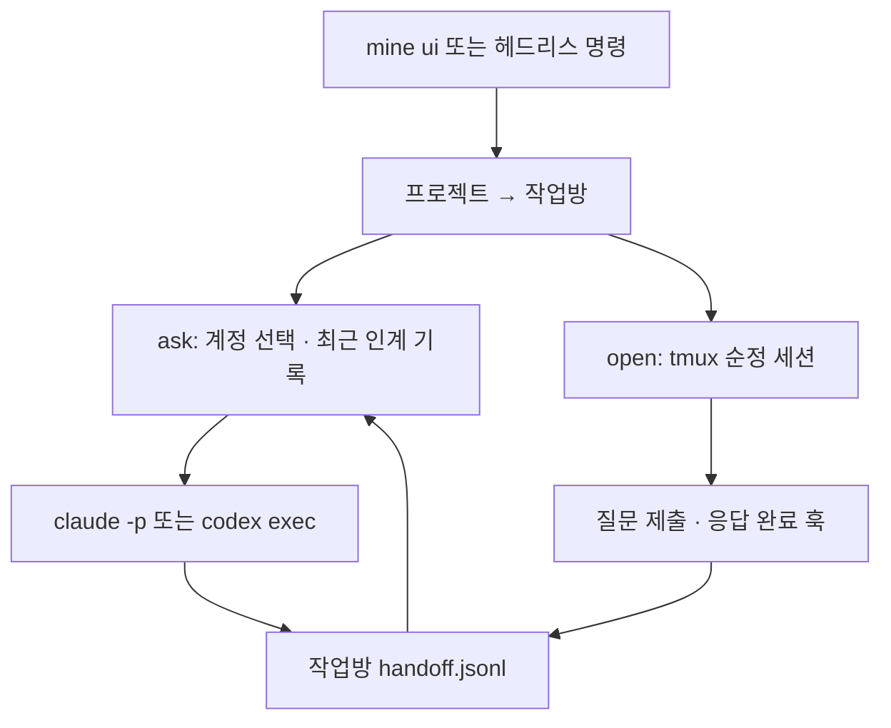

# mine

Claude Code 계정 두 개와 Codex를 한 터미널 작업방에서 사용합니다. 작업을 선택하면 대화·인수인계 메모를 함께 보고, 사용할 계정과 모델을 정할 수 있습니다. 순정 CLI는 tmux에서 실행합니다.

## 설계와 구현 상태

`mine`은 한 호스트에서 작업별로 에이전트를 추천하고, 사용자가 선택한 계정에 작업을 맡긴다. 작업방에는 공유 대화를, 계정별 CLI에는 해당 모델의 세션을 보관한다. 따라서 Claude가 작성한 변경을 Codex가 리뷰하고 다시 Claude로 넘길 수 있다.

현재 구현은 Python CLI와 tmux다. Ghostty나 SSH 터미널에서 실행할 수 있다. Rust 스케줄러와 Ratatui 화면은 제안 단계다. 모바일용 호스트 서비스, 기기 페어링, 이벤트 동기화, 사용 한도에 따른 자동 전환도 아직 구현 전이다.



| 코드를 읽는 순서 | 책임 |
|---|---|
| [mine](mine)의 `main`, `console`, `terminal` | CLI와 작업 화면, 프로젝트 전환, tmux 세션 생성·재접속, 훅 입력 처리 |
| [scheduler.py](scheduler.py)의 `Workspace`, `ask`, `context` | 프로젝트 식별과 계정 환경, 실행 디렉터리, 대화 기록과 세션 재개 |
| 같은 파일의 `recommendation`, `refresh_codex`, `native_event` | 계정 추천, 사용량 관측, 순정 세션과 작업방 간 대화 전달 |
| [tests/test_workflow.py](tests/test_workflow.py) | 모의 CLI로 왕복 인계, 실패 기록, 한도 소진, 프로젝트 격리를 검증 |

**상태의 범위.** 기본 저장 위치는 `~/.mine`이다. `projects/<key>.json`은 실제 프로젝트 경로를, `rooms/<key>/<room>/handoff.jsonl`은 작업 기록을 보관한다. 키는 실제 경로를 SHA-256으로 해시한 앞 16자리다. `profiles/<agent>`의 Claude 설정과 `usage/<agent>.json`의 사용량 관측값은 같은 호스트의 여러 프로젝트가 공유한다. Codex는 사용자의 기존 Codex 로그인을 사용한다.

**한 턴의 처리.** `ask`는 작업방의 `turn.lock`을 잡고 사용자 요청을 기록한 뒤 프로젝트 루트에서 CLI를 실행한다. 같은 계정의 마지막 성공 응답에 세션 ID가 있으면 그 세션을 재개하고 그 뒤에 쌓인 공유 기록을 전달한다. 첫 요청에는 방의 최근 기록을 전달한다. 전달 텍스트는 최근 16,000자로 제한하고 전체 기록 경로도 제공한다. 성공 응답에 세션 ID를 저장하며, 실패하면 오류를 기록한다. 실패 전에 실행한 파일 편집이나 외부 명령은 이미 반영됐을 수 있다.

**동시 실행의 경계.** 잠금은 같은 방의 `ask` 호출끼리 적용된다. 순정 tmux 세션과 서로 다른 작업방은 독립적으로 움직이므로, 동일 파일을 병렬 편집할 때는 별도 worktree를 사용하거나 편집이 끝난 후 인계한다. 사용량에는 관측 시각이 붙고 추천은 계정을 직접 전환하지 않는다.

**다음 에이전트의 출발점.** Rust 이식에 착수한다면 기존 상태 디렉터리를 복사한 테스트 환경에서 메모 읽기, Claude → Codex → Claude 왕복, 하위 폴더에서의 프로젝트 선택을 먼저 검증한다. 모바일 확장에서는 호스트가 작업 실행을 유지하고 클라이언트가 같은 작업방에 재접속하는 것을 목표로 한다. 현재 SSH 접속과 장래의 모바일 서비스는 배포 방식이 다르다.

## 시작

macOS 또는 Linux에서 Python 3.8+, tmux 3.2+, Claude Code, Codex CLI가 필요합니다. 파일 변경 보기에는 GitButler CLI(`but`)를 사용합니다. 저장소에서 `export PATH="$PWD:$PATH"`를 실행한 뒤 작업할 저장소 안으로 이동하세요.

```sh
mine login claude-a
mine login claude-b
mine login codex
mine ui payments
```

두 Claude 계정은 별도의 설정 디렉터리를 쓰며, Codex는 기존 사용자 로그인을 사용합니다. 처음 설정할 때 각 CLI에서 활성 로그인 방법을 확인하세요. 실제 요청은 선택한 계정의 사용량을 소비합니다.

## 프로젝트와 작업방

`mine`은 현재 위치에서 위로 올라가며 가장 가까운 Git 작업 트리 루트 또는 등록된 프로젝트 폴더를 찾습니다. 처음 연 작업방이 해당 프로젝트를 등록합니다. Git 저장소가 없는 경우에는 현재 폴더가 기준입니다. 별도 worktree와 중첩 저장소는 각각 독립된 프로젝트입니다. 같은 이름의 폴더도 전체 로컬 경로로 구분합니다.

```sh
mine projects
mine --project ~/dev/shop-front ui payments
```

콘솔에서는 `/projects`로 목록을 보고 `/project ~/dev/mine`과 `/room 작업이름`으로 전환합니다. 프로젝트를 바꾸면 대상 폴더의 기본 작업방을 열고 계정을 다시 선택합니다. 에이전트 실행과 파일 변경 보기도 선택한 폴더를 기준으로 합니다. 계정 로그인과 사용량은 호스트 안에서 공유됩니다.

이전 버전에서 하위 폴더를 작업 루트로 사용했으면 `mine --project 기존폴더 history 작업이름`으로 그 폴더의 기존 기록을 열 수 있습니다. 프로젝트 식별에는 실제 경로를 사용하므로 폴더를 이동하면 별개 프로젝트로 열립니다.

## 한 작업에서 Claude → Codex → Claude

작업 화면에 아래 내용을 한 줄씩 입력합니다. 일반 텍스트는 선택한 실행기로 보내고, 답변은 같은 대화 기록에 저장합니다.

```text
/use claude-a sonnet
취소 처리를 수정하고 변경 이유를 설명해줘.
/recommend 독립 코드 리뷰
/use codex
방금 변경한 취소 처리를 리뷰해줘.
/use claude-a
리뷰에서 지적한 부분을 확인해줘.
```

- `/native`는 선택한 계정의 순정 터미널을 엽니다. tmux 안에서는 팝업에 열립니다. 기본 키 `Ctrl-b d`로 분리하면 작업 화면으로 돌아옵니다. 명령 실행이나 권한 승인이 필요한 경우 순정 화면에서 직접 처리할 수 있습니다.
- `/files`는 현재 프로젝트의 미커밋 diff를 보여줍니다. `/history`는 작업 기록 전체, `/room 이름`은 다른 작업방, `/quit`은 화면 종료입니다.
- `/usage`는 Codex App Server에서 한도를 조회하고 Claude 순정 터미널의 상태줄이 마지막으로 관측한 한도와 함께 표시합니다. Claude 상태줄은 첫 모델 응답 후에 값이 생길 수 있습니다. `/recommend`는 최근 15분 이내 관측된 한도, 직전 응답 계정 및 리뷰 요청 여부를 사용합니다. 추천만 표시하며 배정은 사용자가 합니다.
- SSH에서는 같은 호스트·사용자의 같은 프로젝트 경로에서 실행하세요. 공통 화면의 요청도 SSH를 끊은 뒤 계속 실행하려면 `tmux new -A -s mine-console` 안에서 `mine ui payments`를 실행하세요.

## 헤드리스 명령

```sh
mine rooms
mine usage
mine recommend payments '취소 처리 리뷰'
mine ask payments codex '이전 변경을 리뷰해줘'
mine note payments '배포는 별도 승인 후 진행'
mine history payments
mine open payments claude-b --model sonnet --detach
mine status payments
```

작업 기록은 `~/.mine/rooms`에 저장합니다. 기존 `handoff.jsonl` 메모도 읽습니다. `MINE_STATE_DIR`로 저장 위치와 Claude 프로필 루트를 변경할 수 있습니다.

## 인계 범위

공통 화면은 계정별 CLI 세션 ID를 저장해 다음 요청에 재사용합니다. 계정 전환 시 최근 공유 기록(최대 16,000자)과 전체 기록 경로를 전달합니다. 작업방 이름이 같아도 프로젝트 경로가 다르면 기록이 분리됩니다.

새로 연 순정 세션에서는 `UserPromptSubmit`과 `Stop` 훅이 사용자 질문과 최종 답변을 같은 기록에 추가합니다. **Codex 순정 세션에서 새 훅 검토가 표시되면 `/hooks`에서 해당 작업방의 mine 훅을 확인하세요.** 훅이 꺼져 있거나 구버전으로 열린 세션이면 순정 대화 수집이 작동하지 않습니다. 기존 세션은 작업을 마치고 CLI를 종료한 뒤 다시 열면 새 설정을 받습니다. Claude 순정 세션에서는 mine 사용량 표시줄이 적용됩니다.

공통 화면과 순정 터미널은 대화와 작업 파일을 공유합니다. 실행 중인 도구의 승인이나 중간 출력은 해당 순정 세션에 남습니다. 순정 터미널에서 파일을 편집 중이라면 그 턴이 끝난 뒤 넘기세요. 실패한 요청은 기록에 표시되며 자동 재실행되지 않습니다.

`python3 -B -m unittest discover -s tests -v`로 실제 모델 호출 없이 계정 간 왕복과 실패 처리를 검증할 수 있습니다.
