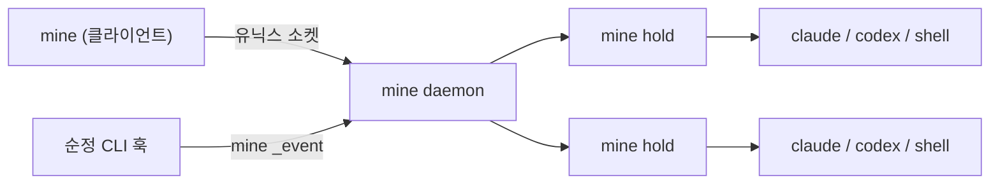

# mine

Ghostty 안에서 tmux를 대신하는 AI 코딩 에이전트용 터미널 멀티플렉서입니다. Claude Code 계정 두 개와 Codex, 일반 셸 세션을 프로젝트별로 묶어 보여 주고, 화면을 닫거나 SSH가 끊겨도 세션은 계속 돕니다. Rust 바이너리 하나(`mine`)로 동작합니다.

## 설계와 구현 상태

설계는 [docs/superpowers/specs/2026-11-20-mine-multiplexer-design.md](docs/superpowers/specs/2026-11-20-mine-multiplexer-design.md)에, 구현 순서는 [docs/superpowers/plans/2026-11-20-mine-core.md](docs/superpowers/plans/2026-11-20-mine-core.md)에 있다. 화면 목업은 [docs/superpowers/specs/2026-11-20-mine-mockups](docs/superpowers/specs/2026-11-20-mine-mockups)에 있다.

구조는 세 층이다. 클라이언트(`mine`)는 화면을 그리고 키를 받는다. 데몬(`mine daemon`)은 세션 목록과 상태, 세션마다의 터미널 화면을 유지한다. 세션 PTY는 세션마다 따로 뜨는 보관 프로세스(`mine hold`)가 쥐므로, 클라이언트를 닫거나 데몬이 재시작돼도 claude·codex·shell 프로세스는 계속 돈다. 데몬은 `mine`이 처음 실행될 때 알아서 뜬다.



현재는 설계의 1단계(데몬과 세션)가 구현돼 있다. 나머지 단계는 아래 "지금 되는 것과 아직 안 되는 것"에 정리했다. 예전 Python 프로토타입(`mine ask`, 작업방, 계정 간 대화 인계)은 이 Rust 구현으로 교체했고, 그 기록(`~/.mine/rooms`)은 옮기지 않는다.

## 설치

Rust 1.89 이상이 필요합니다. 세션 종류에 맞는 CLI(`claude`, `codex`)는 따로 설치하고 로그인해 두세요. 저장소 루트에서 실행합니다.

```sh
cargo install --path crates/mine-cli
```

`~/.cargo/bin`이 PATH에 있어야 합니다. 새 셸에서 `command -v mine`으로 확인하세요. 예전에 Python 프로토타입을 쓰려고 `~/.local/bin/mine` 링크를 만들었다면 지우세요. 그 링크는 이제 없는 스크립트를 가리켜 `mine`이 실행되지 않습니다.

```sh
rm ~/.local/bin/mine
```

기준 환경은 macOS(Apple Silicon)와 Ghostty다. tmux는 필요 없다.

## 업그레이드

새 버전을 설치해도 이미 떠 있는 데몬은 옛 코드로 계속 돈다. 설치한 뒤 데몬을 한 번 끝내면 다음 `mine`이 새 데몬을 띄운다. 저장소 루트에서 실행한다.

```sh
cargo install --path crates/mine-cli
kill "$(cat ~/.mine/daemon.pid)"    # MINE_STATE_DIR를 쓰면 kill "$(cat "$MINE_STATE_DIR/daemon.pid")"
mine
```

- 세션은 죽지 않는다. 세션 PTY는 세션마다 따로 뜬 보관 프로세스(`mine hold`)가 쥐고 있고, 새 데몬이 떠서 다시 붙는다. 화면은 보관 프로세스의 최근 출력으로 다시 만든다.
- 데몬이 끝나면 붙어 있던 `mine` 화면은 "데몬 연결이 끊겼다"로 끝난다. `mine`을 다시 실행하면 같은 세션에 다시 붙는다.
- 프로토콜 버전이 다른 데몬에 붙으면 `mine`이 위 `kill` 명령을 실제 pid 파일 경로와 함께 알려 준다.
- 이미 떠 있는 세션의 보관 프로세스는 세션이 끝날 때까지 옛 `mine hold`로 돈다. 새로 만드는 세션부터 새 버전을 쓴다.

## 실행

프로젝트 폴더 안에서 실행한다. 현재 위치에서 위로 올라가며 가장 가까운 Git 작업 트리 루트를 프로젝트로 쓰고, Git 저장소가 없으면 등록된 폴더나 현재 폴더를 쓴다. 홈 폴더(`~`)와 `/`는 등록하지 않는다. 홈에서 실행하면 홈이 그 세션의 프로젝트지만, 홈 아래 Git 저장소가 없는 다른 폴더까지 홈으로 묶이지는 않는다. 별도 worktree와 중첩 저장소는 각각 독립된 프로젝트다.

```sh
mine                                  # 화면을 연다
mine ls                               # 세션 목록
mine new rust-core --kind claude --account claude-b --model opus
mine new dev                          # 종류를 생략하면 shell
mine kill rust-core                   # 세션을 닫는다
mine projects                         # 등록된 프로젝트
mine --project ~/dev/mine new dev     # 프로젝트 폴더를 직접 지정한다
```

- `mine`: 아이콘 줄, 상태별 목록, 선택한 세션의 터미널로 이루어진 화면이다. 데몬이 없으면 띄운다. 붙은 세션이 없으면 터미널 칸에 시작 화면이 뜬다(아래 "시작 화면").
- `mine ls`: 한 줄에 `기호 프로젝트폴더 이름 계정 상태 대기문구`를 탭으로 나눠 쓴다. 빈 칸은 `-`다. 세션이 없으면 아무것도 출력하지 않는다.
- `mine new <이름> [--kind claude|codex|shell] [--account claude-a|claude-b|codex] [--model 모델]`: 이름은 프로젝트 안에서 고유해야 한다. 영문·숫자로 시작하고 영문·숫자·`_~-`만 쓰며 64자 이하다. 종류를 생략하면 `shell`이다. `--account`를 생략한 claude 세션은 기본 설정 폴더(`~/.claude`)를 쓴다.
- `mine kill <이름>`: 세션을 닫는다. 세션 폴더와 기록은 남는다.
- `--project`는 하위 명령 앞에 쓴다. 생략하면 현재 위치에서 프로젝트를 찾는다.

## 키

접두 키는 `⌃a`다. `⌃a`를 누른 뒤 아래 키를 누른다.

| 키 | 동작 |
|---|---|
| `⌃a ⌃a` | 세션에 `⌃a`(0x01) 자체를 보낸다 |
| `⌃a n` / `⌃a p` | 다음 / 이전 세션. 목록에 보이는 순서이며 끝에서 처음으로 돈다 |
| `⌃a )` / `⌃a (` | 다음 / 이전 프로젝트 |
| `⌃a 0` | 모든 프로젝트 |
| `⌃a c` | 새 세션. 시작 화면을 열어 키 하나로 종류를 고른다(아래 "시작 화면"). Esc로 닫는다 |
| `⌃a x` | 현재 세션 닫기. `y`를 누르면 닫고, 다른 키는 취소 |
| `⌃a b` | 목록 접기 / 펴기. 접으면 아이콘 줄만 남는다 |
| `⌃a [` | 복사 모드 |
| `⌃a d` | 화면에서 떼기. 세션은 계속 돈다 |

**시작 화면.** 붙은 세션이 없으면(프로젝트에 세션이 없을 때, 붙은 세션이 사라졌을 때) 터미널 칸 가운데에 프로젝트 이름과 경로, 새 세션 메뉴가 뜬다. `⌃a c`는 세션이 붙어 있어도 이 화면을 세션 위에 연다.

| 키 | 동작 |
|---|---|
| Enter | `claude-a` 세션을 만든다 |
| `b` | `claude-b` 세션을 만든다 |
| `x` | `codex` 세션을 만든다 |
| `s` | `shell` 세션을 만든다 |
| `n` | 상태줄에 `<claude-a\|claude-b\|codex\|shell> <이름> [모델]`을 직접 쓰고 Enter(Esc는 시작 화면으로 돌아간다) |
| Esc | 세션 위에 연 시작 화면을 닫는다. 붙은 세션이 없으면 돌아갈 곳이 없어 아무 일도 없다 |

메뉴를 고르면 세션이 바로 만들어지고 붙는다. 이름은 프로젝트에서 쓰지 않은(끝난 세션 포함) 가장 작은 `t1`, `t2`, … 이다. 메뉴 줄을 클릭해도 같다. 그 밖의 키는 무시하고, `⌃a` 명령은 그대로 동작한다. 한글 입력 상태에서는 키가 한글로 와 동작하지 않고 상태줄이 `한/영을 영문으로 바꾸고 다시 누르세요`라고 알린다. 시작 화면, `⌃a` 뒤의 키, 복사 모드(검색어 입력 중이 아닐 때)가 그렇고, 세션·`n` 입력·검색어에 치는 한글은 그대로다.

**복사 모드.** 스크롤백을 얼려 놓고 키보드로 움직이며 복사한다.

| 키 | 동작 |
|---|---|
| `h` `j` `k` `l` 또는 방향키 | 커서 이동 |
| `g` / `G` | 맨 위 / 맨 아래 |
| `0` / `$` | 줄 처음 / 줄 끝 |
| PgUp / PgDn, `⌃b` / `⌃f` | 한 쪽 위 / 아래 |
| `⌃u` / `⌃d` | 반 쪽 위 / 아래 |
| 휠 | 세 줄 위 / 아래 |
| `/` / `?` | 아래로 / 위로 검색어 입력(Enter로 찾기, Esc로 입력 취소, 빈 Enter는 마지막 검색 반복). 대소문자를 가리지 않는다 |
| `n` / `N` | 같은 방향 / 반대 방향 다음 일치 |
| `v` | 선택 시작 / 해제 |
| `y` 또는 Enter | 선택 영역을 복사하고 복사 모드를 끝낸다. 선택이 없으면 그냥 끝낸다 |
| `q` 또는 Esc | 복사 모드를 끝낸다 |

**마우스.**

- 휠: 세션 터미널의 스크롤백을 움직인다. 세션 프로그램이 마우스를 직접 받으면 그 프로그램에 넘긴다.
- 드래그: 선택하고, 손을 떼면 OSC 52로 클립보드에 복사한다. Ghostty가 ⌘C를 가로채므로 이 방식을 쓴다.
- 클릭: 아이콘 줄의 프로젝트나 목록의 세션 줄을 고른다. 그룹 머리글을 누르면 그룹을 접거나 편다. 시작 화면에서는 메뉴 줄을 누르면 그 줄을 시작한다.

## 상태 폴더

기본 위치는 `~/.mine`이고 `MINE_STATE_DIR`로 바꾼다. 유닉스 소켓 경로가 macOS 한도(104바이트)를 넘지 않도록 짧은 경로를 쓴다.

```text
~/.mine/
  daemon.sock           클라이언트가 붙는 유닉스 소켓
  daemon.pid            데몬이 하나만 뜨게 하는 잠금 파일
  projects/<key>.json   등록된 프로젝트의 실제 경로. key는 경로 SHA-256의 앞 16자
  sessions/<id>/        meta.json, events.jsonl(훅 이벤트), exit(자식 종료 코드)
  run/                  보관 프로세스 소켓
  logs/                 daemon.log, hold-<id>.log
  profiles/claude-b/    claude-b의 CLAUDE_CONFIG_DIR
```

claude-a는 지금의 `~/.claude`를 그대로 쓴다. 설계 5.9의 `config.toml`, `usage/`, `master/`, 세션의 대화·인계 기록은 이후 단계에서 생긴다.

## 지금 되는 것과 아직 안 되는 것

**되는 것(1단계).** 프로젝트 단위로 claude·codex·shell 세션을 만들고 전환하고 닫는다. 아이콘 줄과 상태별 목록(◆ 승인 대기, ◐ 작업 중, ✓ 끝남, ○ 대기)이 순정 CLI 훅으로 정한 상태를 보여 준다. shell 세션은 출력이 있으면 작업 중, 2초 동안 출력이 없으면 대기다. 화면을 닫아도 세션이 계속 돌고, 다시 붙으면 현재 화면이 복구된다. 프로세스가 끝난 claude·codex 세션은 `종료됨`으로 남아, 고르면 같은 대화를 다시 띄운다. 스크롤백, 드래그 복사, 복사 모드를 쓸 수 있다.

**아직 안 되는 것(2–8단계).**

- 2단계: 계정 한도 수집과 경고, `⌃a s` 넘기기와 인계, claude 두 계정의 설정 공유
- 3단계: 재부팅 뒤 세션 복원
- 4단계: git graph와 files 칸
- 5단계: 원격 호스트
- 6단계: 마스터 세션
- 7단계: 브라우저 칸
- 8단계: 설치 한 줄로 PATH에 넣는 배포(Homebrew). 그 전까지는 `cargo install --path crates/mine-cli`를 쓴다.

**알려진 한계(설계 5.12).** 안쪽 앱이 켠 키보드 모드(modifyOtherKeys, kitty 키보드, DECCKM)는 바깥 터미널로 넘긴다. kitty 키보드의 키 뗌·반복 보고(플래그 2)만은 넘기지 않는다. Shift+Enter와 한글 조합 위치는 tmux로만 확인했고, Ghostty에서의 확인이 남았다. kitty 이미지 깜박임, 입력 지연 체감, Ghostty에서의 Codex 색도 아직 Ghostty에서 확인하지 못했다.

## 개발 브랜치와 인수인계 규칙

장기 브랜치는 `main`과 `dev`다. `main`은 릴리스 기준선이고, 다음 개발자는 `dev`에서 최신 구현을 확인한다. 로컬 체크아웃 위치의 예는 `~/dev/mine`이다. 브랜치 이름과 체크아웃 폴더는 독립적이다.

1. 작업 시작 시 GitButler의 `but status -fv`로 현재 브랜치와 다른 작업자의 변경을 확인한다. 새 작업은 최신 `dev` 위에서 시작하고, 서로 의존하는 커밋은 의존 순서대로 쌓는다.
2. 한 커밋은 독립적으로 설명하고 되돌릴 수 있는 동작 하나를 담는다. 그 동작에 필요한 테스트와 호환 처리를 함께 넣는다. 저장 형식을 바꾸면 기존 작업 기록을 읽는지와 이전 버전으로 복귀했을 때 데이터에 미치는 영향도 확인한다.
3. 각 커밋의 파일 상태에서 `cargo fmt --check && cargo clippy --workspace --all-targets -- -D warnings && cargo test --workspace`를 실행한다. 동작을 바꿨다면 영향을 받는 CLI 진입점도 검증한다. 나중 커밋에 들어갈 미커밋 변경이 있다면 임시 worktree에서 해당 커밋만 검증한다. 중간 커밋이 깨지면 공개 전에 원인이 속한 커밋을 고치고 이후 커밋까지 재검증한다.
4. 병행 작업은 공개 전 최신 `dev` 위로 rebase하고 테스트한 뒤 fast-forward로 반영한다. 릴리스할 때는 검증한 `dev`까지 `main`을 fast-forward한다. 분기 때문에 fast-forward가 불가능하면 먼저 차이를 검토한다. 이미 공유된 브랜치의 강제 푸시나 이력 재작성은 소유자와 합의한다.
5. 공유 후 롤백은 동작을 취소하는 새 커밋으로 기록한다. 의존하는 변경을 함께 되돌릴 때는 최신 커밋부터 역순으로 처리하고 같은 테스트를 실행한다. 코드 롤백과 작업 기록·외부 시스템의 복구는 별도로 확인한다.

커밋 제목은 `type(scope): 한글 명령형 요약`을 사용한다. 허용 타입은 `feat|fix|refactor|docs|chore|style|perf|test`이다. 스코프는 변경한 책임을 드러내도록 선택한다. 예를 들어 CLI 명령은 `cli`, 배정 규칙은 `scheduler`, 대화 인계는 `handoff`, 설계 설명은 `architecture`, 개발 규칙은 `workflow`를 쓴다. 본문에는 실제로 바꾼 동작, 그 이유, 검증한 내용과 남은 제약을 적는다. 예시:

```text
fix(handoff): 실패한 턴 이후 마지막 성공 세션을 재개한다

CLI 요청이 실패해도 같은 계정의 마지막 성공 세션 ID를 선택한다.
실패 기록을 타임라인에 보존해 다음 작업자가 파일 상태를 확인할 수 있게 한다.

검증: 성공 → 실패 → 재개 시나리오에서 전달한 세션 ID를 확인했다.
```
