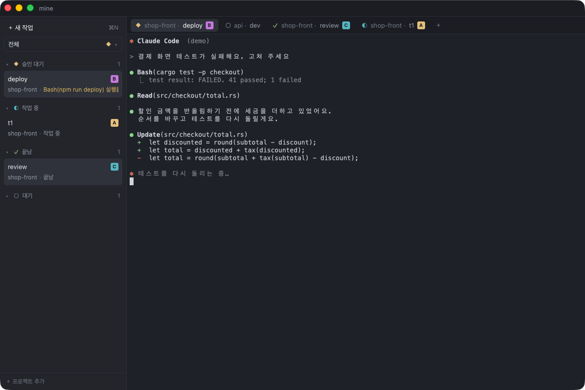
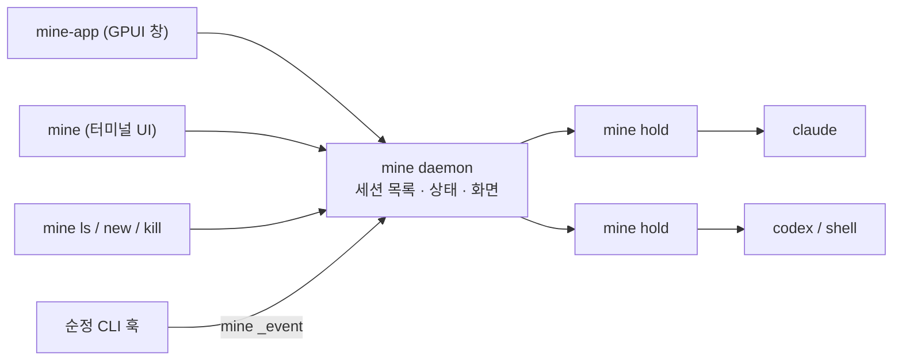

<div align="center">

# mine

**AI 코딩 에이전트를 위한 나만의 작업 공간**

Claude Code 계정 두 개, Codex, 일반 셸 세션을 프로젝트별로 한눈에 봅니다.<br>
화면을 닫거나 SSH가 끊겨도 세션은 계속 돕니다.

[](#라이선스)
[](https://www.rust-lang.org)
[](#설치)



<sub>데스크톱 앱(개발 중). 왼쪽은 상태별 작업 목록, 위는 세션 탭, 가운데는 세션 터미널입니다.</sub>

</div>

## 왜 mine인가요

Ghostty에서 tmux로 에이전트 세션을 여러 개 띄워 쓰다 보면 이런 일이 생깁니다.

- 어느 프로젝트에서 어떤 에이전트가 승인을 기다리는지 한눈에 보이지 않아요.
- 한 계정의 한도가 바닥나면 다른 계정으로 옮기면서 맥락을 다시 설명해야 해요.
- 원격 머신의 세션을 오가는 일이 번거로워요.

mine은 "어느 터미널에 접속할까"가 아니라 **"지금 이 작업을 어느 에이전트·계정에 맡길까"** 에 답하는 도구를 목표로 합니다.

## 특징

- **상태별 작업 목록.** 모든 프로젝트의 세션을 `◆ 승인 대기 → ◐ 작업 중 → ✓ 끝남 → ○ 대기` 순서로 묶어 보여 줘요. 상태는 Claude Code와 Codex의 순정 훅으로 정해요.
- **죽지 않는 세션.** 세션마다 따로 뜨는 보관 프로세스가 PTY를 쥐고 있어서, 화면을 닫거나 데몬을 다시 띄워도 claude·codex·shell 프로세스는 계속 돌아요. 다시 붙으면 같은 화면이 돌아와요.
- **계정 두 개.** claude-a(`~/.claude`)와 claude-b(따로 로그인한 프로필)를 세션마다 골라 써요. 화면에는 로그인 이메일 앞부분이나 직접 정한 별칭이 보여요.
- **키 하나로 시작.** 시작 화면에서 ↵ / `b` / `x` / `s` 한 번으로 claude-a / claude-b / codex / shell 세션을 바로 만들어요.
- **tmux 수준의 스크롤과 복사.** 휠 스크롤, 드래그 복사(OSC 52), `⌃a [` 복사 모드(쪽 넘김, 검색)를 지원해요.
- **순정 CLI 그대로.** 세션 화면은 Claude Code와 Codex를 그대로 띄워요. 키보드 모드(kitty 키보드, modifyOtherKeys)도 바깥 터미널로 넘겨서 Shift+Enter가 그대로 동작해요.

## 상태

| 단계 | 내용 | 상태 |
|---|---|---|
| 1 | 데몬, 보관 프로세스, 터미널 UI(`mine`), 상태별 목록, 복사 모드 | ✅ 사용 가능 |
| D1 | 데스크톱 앱 창 뼈대: 작업 목록, 세션 탭, 시작 화면, 터미널 칸 | 🚧 개발 중 (입력·마우스·알림·`.app` 남음) |
| D2 | 데스크톱 앱 채팅 화면(Claude·Codex 대화, 승인 버튼, 서브에이전트 카드) | ⏳ 계획 |
| D3 | Changes 칸(미커밋 변경 트리와 커밋 목록) | ⏳ 계획 |
| 2–8 | 계정 한도 넘기기, 재부팅 복원, git graph, 원격, 마스터 세션, 브라우저 칸, Homebrew 배포 | ⏳ 계획 |

설계는 [멀티플렉서 설계](docs/superpowers/specs/2026-11-20-mine-multiplexer-design.md)와 [데스크톱 앱 설계](docs/superpowers/specs/2026-11-23-mine-desktop-design.md)에 있어요.

## 설치

macOS(Apple Silicon)와 Rust 1.89 이상이 필요해요. 쓰려는 에이전트 CLI(`claude`, `codex`)는 따로 설치하고 로그인해 두세요.

```sh
git clone https://github.com/oyobbeb/mine.git
cd mine
cargo install --path crates/mine-cli
```

`~/.cargo/bin`이 PATH에 있어야 해요. 새 셸에서 `command -v mine`으로 확인하세요.

> [!NOTE]
> 예전에 패키지 이름이 `mine`이던 판을 설치했다면 처음 한 번은 `cargo install --path crates/mine-cli --force`로 덮어써야 해요.

## 빠른 시작

프로젝트 폴더 안에서 실행하세요. 가장 가까운 Git 작업 트리 루트가 프로젝트가 돼요.

```sh
mine                 # 화면을 열어요. 세션이 없으면 시작 화면이 떠요
mine ls              # 세션 목록
mine new dev         # shell 세션 "dev"를 만들어요
```

화면에서는 `⌃a`(Control+a)를 누른 뒤 명령 키를 누릅니다. 예를 들어 `⌃a d`는 Control+a를 누르고 손을 뗀 다음 `d`를 눌러요. 화면에서만 나가고 세션은 계속 돌아요.

## 사용법

### 명령

```sh
mine                                  # 화면을 연다
mine ls                               # 세션 목록 (탭으로 나눈 기계용 출력)
mine new rust-core --kind claude --account claude-b --model opus
mine new dev                          # 종류를 생략하면 shell
mine kill rust-core                   # 세션을 닫는다(세션 폴더와 기록은 남는다)
mine projects                         # 등록된 프로젝트
mine --project ~/dev/app new dev      # 시작 폴더를 직접 지정한다
```

- `mine ls`는 한 줄에 `기호 프로젝트폴더 이름 계정 상태 대기문구`를 탭으로 나눠 써요. 빈 칸은 `-`예요.
- 세션 이름은 프로젝트 안에서 고유해야 하고, 영문·숫자로 시작해 영문·숫자·`_~-`만 64자까지 써요.
- `--project`는 하위 명령 앞에 써요. 그 폴더에서 위로 올라가며 프로젝트를 찾아요.

### 키

| 키 | 동작 |
|---|---|
| `⌃a ⌃a` | 세션에 `⌃a` 자체를 보내요 |
| `⌃a n` / `⌃a p` | 다음 / 이전 세션 |
| `⌃a )` / `⌃a (` | 다음 / 이전 프로젝트 |
| `⌃a 0` | 모든 프로젝트 |
| `⌃a c` | 새 세션(시작 화면) |
| `⌃a x` | 현재 세션 닫기(`y`로 확인) |
| `⌃a b` | 목록 접기 / 펴기 |
| `⌃a [` | 복사 모드 |
| `⌃a d` | 화면에서 나가기(세션은 계속 돌아요) |

<details>
<summary><b>시작 화면</b></summary>

붙은 세션이 없으면 터미널 칸 가운데에 새 세션 메뉴가 떠요. `⌃a c`는 세션 위에 이 화면을 열어요.

| 키 | 동작 |
|---|---|
| Enter / `b` / `x` / `s` | claude-a / claude-b / codex / shell 세션을 만들어 바로 붙어요 |
| `n` | `<claude-a\|claude-b\|codex\|shell> <이름> [모델]`을 직접 입력해요 |
| Esc | 세션 위에 연 시작 화면을 닫아요 |

이름은 프로젝트에서 쓰지 않은 가장 작은 `t1`, `t2`, … 가 돼요. 메뉴 줄을 클릭해도 같아요. 한글 입력 상태에서 명령 키를 누르면 `한/영을 영문으로 바꾸고 다시 눌러 주세요`라고 알려 줘요.

</details>

<details>
<summary><b>복사 모드</b></summary>

스크롤백을 얼려 놓고 키보드로 움직이며 복사해요.

| 키 | 동작 |
|---|---|
| `h` `j` `k` `l` / 방향키 | 커서 이동 |
| `g` / `G` | 맨 위 / 맨 아래 |
| `0` / `$` | 줄 처음 / 줄 끝 |
| PgUp / PgDn, `⌃b` / `⌃f` | 한 쪽 위 / 아래 |
| `⌃u` / `⌃d` | 반 쪽 위 / 아래 |
| `/` / `?` | 아래로 / 위로 검색(대소문자 구분 없음) |
| `n` / `N` | 같은 방향 / 반대 방향 다음 일치 |
| `v` | 선택 시작 / 해제 |
| `y` / Enter | 복사하고 끝내기 |
| `q` / Esc | 끝내기 |

</details>

<details>
<summary><b>마우스</b></summary>

- 휠: 스크롤백을 움직여요. 세션 프로그램이 마우스를 받으면 그 프로그램에 넘겨요.
- 드래그: 고르고 손을 떼면 OSC 52로 클립보드에 복사해요.
- 클릭: 프로젝트 아이콘, 세션 줄, 그룹 머리글(접기/펴기), 시작 화면 메뉴를 골라요.

</details>

### 데스크톱 앱 (개발 중)

```sh
cargo run -p mine-app
```

같은 데몬에 붙는 GPUI 창이에요. 앱을 닫아도 세션은 계속 돌아요. 지금은 작업 목록, 세션 탭, 시작 화면, 터미널 화면 표시까지 돼요. 키 입력, 마우스 선택, 승인 알림, `.app` 묶음은 개발 중이에요.

## 설정

### 계정 이름

화면에는 계정 id(`claude-a` …) 대신 짧은 이름이 보여요. 정하는 차례는 다음과 같아요.

1. 별칭: `~/.mine/config.toml`에 적어요.

   ```toml
   [accounts.claude-a]
   label = "개인"

   [accounts.claude-b]
   label = "회사"
   ```

2. 자동 이름: 각 Claude 프로필의 로그인 이메일 `@` 앞부분. Codex는 `Codex`예요.
3. 둘 다 없으면 계정 id 그대로예요.

mine은 자격 증명을 읽거나 저장하지 않아요. 자동 이름을 위해 `.claude.json`의 이메일 한 필드만 읽고, 로그에 남기지 않아요. 별칭은 화면에만 쓰여서 `mine ls`, `mine new --account`, 시작 화면의 `n` 입력은 계정 id를 그대로 써요.

### 상태 폴더

기본 위치는 `~/.mine`이고 `MINE_STATE_DIR`로 바꿀 수 있어요.

```text
~/.mine/
  daemon.sock           클라이언트가 붙는 유닉스 소켓
  daemon.pid            데몬이 하나만 뜨게 하는 잠금 파일
  config.toml           계정 별칭(선택)
  projects/<key>.json   등록된 프로젝트 경로
  sessions/<id>/        meta.json, events.jsonl(훅 이벤트), exit
  run/                  보관 프로세스 소켓
  logs/                 daemon.log, hold-<id>.log
  profiles/claude-b/    claude-b의 CLAUDE_CONFIG_DIR
```

## 업그레이드

새 판을 설치해도 이미 떠 있는 데몬은 옛 코드로 돌아요. 설치한 뒤 데몬을 한 번 끝내면 다음 `mine`이 새 데몬을 띄워요. 세션은 보관 프로세스가 쥐고 있어서 죽지 않아요.

```sh
cargo install --path crates/mine-cli
kill "$(cat ~/.mine/daemon.pid)"
mine
```

## 동작 방식



- **클라이언트**(`mine`, `mine-app`)는 화면을 그리고 키를 받아요. 유닉스 소켓의 JSON 줄 프로토콜로 데몬에 붙어요.
- **데몬**(`mine daemon`)은 세션 목록과 상태, 세션마다의 터미널 화면([alacritty_terminal](https://github.com/alacritty/alacritty))을 유지해요. 처음 `mine`을 실행할 때 알아서 떠요.
- **보관 프로세스**(`mine hold`)가 세션마다 PTY를 쥐어요. 그래서 데몬이 다시 떠도 세션이 살아요.

| 크레이트 | 역할 |
|---|---|
| [`crates/mine-core`](crates/mine-core) | 공용 라이브러리: 프로토콜, 세션 타입, 화면, 데몬 연결 |
| [`crates/mine-cli`](crates/mine-cli) | `mine` 실행 파일: 명령, 데몬, 보관 프로세스, 터미널 UI |
| [`crates/mine-app`](crates/mine-app) | `mine-app` 실행 파일: GPUI 데스크톱 앱 |

## 개발

```sh
cargo fmt --check && cargo clippy --workspace --all-targets -- -D warnings && cargo test --workspace
```

- 설계 문서와 구현 계획은 [`docs/superpowers`](docs/superpowers)에 있어요.
- 커밋 제목은 `type(scope): 한글 명령형 요약`을 써요. 타입은 `feat|fix|refactor|docs|chore|style|perf|test`이고, 스코프는 `cli`, `app`, `daemon`, `screen`, `accounts`, `workspace`, `architecture`, `workflow`처럼 바꾼 책임을 드러내요. 본문에는 바꾼 동작, 이유, 검증을 적어요.
- 한 커밋은 독립적으로 설명하고 되돌릴 수 있는 동작 하나를 담고, 각 커밋에서 위 검사가 통과해야 해요.

## 라이선스

다음 둘 중 하나를 골라 쓸 수 있어요.

- [Apache License 2.0](LICENSE-APACHE)
- [MIT License](LICENSE-MIT)

따로 밝히지 않는 한, 이 저장소에 기여한 코드는 Apache-2.0 라이선스 정의에 따라 위 두 라이선스로 함께 배포하는 데 동의한 것으로 봐요.
