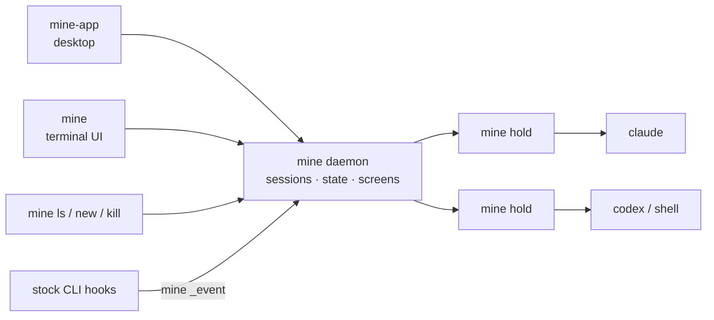

<div align="center">


# mine

**Your coding-agent sessions, never interrupted.**

Claude Code and Codex sessions that keep running across windows, accounts, machines, and dropped connections.

[Install](#install) &nbsp;•&nbsp; [Quick start](#quick-start) &nbsp;•&nbsp; [How it works](#how-it-works) &nbsp;•&nbsp; [Roadmap](#roadmap) &nbsp;•&nbsp; [한국어](README.ko.md)


</div>

## About

Agent work rarely fits in one sitting. A refactor outlives your terminal window, an account hits its usage limit halfway through, or you want to check on a task from another machine. Each time, the session — and the context built up in it — is the thing you lose.

mine treats a session as something that outlives everything around it. A small daemon owns every Claude Code, Codex, and shell session. Windows and SSH connections come and go, and you pick the session back up where you left it: in the desktop app, in a terminal over SSH, and eventually on another account or another host.

> [!NOTE]
> mine is early and shaped around one person's workflow on macOS (Apple Silicon). Sessions that survive disconnects work today; account handoff and remote hosts are next. See the [roadmap](#roadmap).

## Highlights

- **Sessions outlive their window.** Each session's PTY is held by its own holder process. Close the app, lose SSH, or restart the daemon, and `claude`, `codex`, and your dev server keep running. Reattach and the screen comes back.
- **Exited conversations resume.** A Claude or Codex session whose process ended stays in the list as *Exited*. Select it and the same conversation starts again.
- **Any number of logins, one list.** Profiles run Claude and Codex sessions on as many separately logged-in accounts as you like, side by side. They share your skills, commands, settings and MCP servers, and each shows as your login name or a label you choose.
- **See what needs you.** Sessions from every project are grouped as *Needs approval → Working → Done → Idle*, driven by the stock CLI hooks.
- **Answer approvals from the list.** Allow or deny a Claude permission request from the app's task list or the terminal UI's approvals panel, without opening the session.
- **One key to start.** The launcher lists every profile and a shell, and starts any of them with a single key.
- **The real CLIs.** Sessions run stock Claude Code and Codex. Keyboard modes (kitty keyboard, modifyOtherKeys) pass through, so Shift+Enter just works.
- **Desktop app and terminal UI.** A GPUI desktop app for daily use and a terminal UI for SSH, both attached to the same daemon.

## Install

Requires macOS and Rust 1.89 or newer. Install and log in to the agent CLIs you want to use (`claude`, `codex`) separately.

```sh
git clone https://github.com/oyobbeb/mine.git
cd mine
cargo install --path crates/mine-cli
```

Make sure `~/.cargo/bin` is on your `PATH` (`command -v mine`).

The desktop app is built separately. See [Desktop app](#desktop-app).

## Quick start

Run mine inside a project. The nearest Git work tree becomes the project.

```sh
mine            # open the terminal UI; starts the daemon if needed
mine new dev    # create a shell session named "dev"
mine ls         # list sessions
```

Inside the terminal UI, press the prefix `⌃a` (Control+a), release it, then press a command key. `⌃a d` detaches: the UI closes and every session keeps running. Run `mine` again to get back.

## Desktop app

The desktop app shows the same sessions as the terminal UI in a window. It attaches to the same daemon and starts it if needed.

### Build

```sh
scripts/bundle-app.sh                  # builds ~/Applications/mine.app
scripts/bundle-app.sh --dest ./out     # or builds ./out/mine.app
```

The script makes a release build and puts `mine-app` and `mine` in `mine.app/Contents/MacOS`, so the app starts the daemon with the `mine` next to it. The bundle has no icon and isn't signed. To skip the bundle, `cargo install --path crates/mine-app` installs just the `mine-app` binary.

### Run

```sh
mine app
```

`mine app` opens `~/Applications/mine.app`, then `/Applications/mine.app`. If neither exists, it starts a `mine-app` next to `mine` or on your `PATH`. You can also open the bundle from Finder or Spotlight. Started as a binary from a project folder, the app opens that project; started from the Dock or Finder, it uses your home folder.

Closing the window keeps the app in the Dock, and clicking the Dock icon brings the window back. ⌘Q quits only the app; the daemon and your sessions keep running.

### Shortcuts

When the terminal pane has focus, every key without ⌘ goes to the session.

| Key | Action |
|---|---|
| ⌘N | New task (launcher) |
| ⌘W | Close the session (asks first) |
| ⌘1–⌘9 | Select a tab |
| ⌘[ / ⌘] | Previous / next session |
| ⌘⇧[ / ⌘⇧] | Previous / next project |
| ⌘B | Collapse / expand the task list |
| ⌘C / ⌘V | Copy / paste |
| ⌘F | Find in the scrollback (Enter next, ⇧Enter previous, Esc close) |
| ⌘Q | Quit the app |

## Usage

### Commands

```sh
mine                                  # open the terminal UI
mine ls                               # list sessions (tab-separated, script-friendly)
mine new review --profile claude-b --model opus   # --account still works
mine new dev                          # kind defaults to shell
mine kill review                      # close a session (its directory and history stay)
mine profile ls                       # list profiles (more under Configuration)
mine projects                         # list registered projects
mine --project ~/dev/app new dev      # pick the project explicitly
```

- `mine ls` prints `symbol project name account state waiting-text` per line, tab-separated, with `-` for empty fields.
- Session names are unique per project: up to 64 characters, starting with a letter or digit, using letters, digits, and `_~-`.
- `--project` goes before the subcommand. mine walks up from that folder to find the project.

### Keys

| Key | Action |
|---|---|
| `⌃a ⌃a` | Send a literal `⌃a` to the session |
| `⌃a n` / `⌃a p` | Next / previous session |
| `⌃a )` / `⌃a (` | Next / previous project |
| `⌃a 0` | All projects |
| `⌃a c` | New session (launcher) |
| `⌃a a` | Approvals panel (see Approvals below) |
| `⌃a x` | Close the current session (`y` to confirm) |
| `⌃a b` | Collapse / expand the list |
| `⌃a [` | Copy mode |
| `⌃a d` | Detach (sessions keep running) |

<details>
<summary><b>Launcher</b></summary>

When no session is attached, the terminal pane shows the launcher. `⌃a c` opens it over the current session.

| Key | Action |
|---|---|
| `1`–`9` | Create a session on the profile in that row and attach |
| Enter | Create a session on the default Claude profile and attach |
| `s` | Create a shell session and attach |
| `n` | Type `<profile\|shell> <name> [model]` yourself |
| Esc | Close a launcher opened over a session |

The rows are your profiles in config order, then shell. A profile that isn't logged in shows `Not logged in · mine profile login <id>` and doesn't start. New sessions get the smallest unused name in the project: `t1`, `t2`, …. Clicking a menu row does the same. If a Korean input method is active when you press a command key, the status line asks you to switch to English.

</details>

<details>
<summary><b>Copy mode</b></summary>

Freezes the scrollback so you can move around and copy with the keyboard.

| Key | Action |
|---|---|
| `h` `j` `k` `l` / arrows | Move the cursor |
| `g` / `G` | Top / bottom |
| `0` / `$` | Start / end of line |
| PgUp / PgDn, `⌃b` / `⌃f` | Page up / down |
| `⌃u` / `⌃d` | Half page up / down |
| `/` / `?` | Search forward / backward (case-insensitive) |
| `n` / `N` | Next match, same / opposite direction |
| `v` | Start / clear selection |
| `y` / Enter | Copy and exit |
| `q` / Esc | Exit |

</details>

<details>
<summary><b>Mouse</b></summary>

- Wheel scrolls the session's scrollback, or goes to the program if it requested mouse input.
- Drag selects; releasing copies to the clipboard over OSC 52.
- Click picks a project, a session, a group header (collapse / expand), or a launcher row.

</details>

### Approvals

When a Claude session asks to run a tool and nobody is looking at its terminal, mine holds the request for up to 120 seconds and the session shows as *Needs approval*. Answer it from the app or the terminal UI instead of walking over to the session.

- **App:** the session's row in the task list and its tab show **Allow** and **Deny**. Each answers that session's request only.
- **Terminal UI:** `⌃a a` opens the **Approvals** panel. It lists every pending request across your projects, oldest first, as `project/session · summary`, and shows `No pending approvals` when there are none.

  | Key | Action |
  |---|---|
  | ↑ / ↓ | Select a request |
  | `y` | Allow the selected request |
  | `n` | Deny the selected request |
  | Esc | Close the panel |

  The panel only answers the request you selected, and `⌃a n` / `⌃a p` still switch sessions.
- **Handing it back:** the request goes to Claude's own prompt when you start viewing that session's terminal, press a key in it, 120 seconds pass, the daemon restarts, or the hook's connection drops. The panel covers the terminal, so while it's open the session counts as not viewed.
- **What it never does:** `AskUserQuestion` and `ExitPlanMode` always go to Claude's own prompt, since they need more than yes or no. Deny tells Claude `Denied from mine`. There is no "always allow": mine doesn't change your permission rules.
- Codex sessions only show *Needs approval*; there is nothing to answer from mine.

The buttons and the panel need a daemon that holds approvals. After upgrading, restart it as described under Upgrading.

## Configuration

### Profiles

A profile is one login of Claude Code or Codex, with its own config home. Without any setup you have `claude-a` (your `~/.claude`), `codex` (your `~/.codex`), and `claude-b` if `~/.mine/profiles/claude-b` exists. Add as many more as you like:

```sh
mine profile ls                                   # id, kind, label, home, logged in, shared items (tab-separated)
mine profile add team --kind claude --label work  # also --home PATH, --share a,b, --no-share
mine profile login team                           # runs `claude auth login` (Codex: `codex login`) for that profile, in this terminal
mine profile relink team [settings.json]          # puts a shared link back
mine profile rm team                              # removes it from config.toml and keeps its directory
mine new review --profile team                    # --account still works
```

`mine new` without `--profile` uses the default profile of its kind. `add` and `rm` edit `~/.mine/config.toml` in place and keep your comments. A running daemon rereads the profiles right away. These commands never start one.

Profiles live in `~/.mine/config.toml`, in the order the launcher shows them (and the order colors are handed out):

```toml
[profiles.claude-a]          # your own ~/.claude
kind = "claude"
home = "default"
default = true
label = "personal"

[profiles.team]
kind = "claude"
label = "work"
color = "teal"
share = ["skills", "commands"]   # only these are shared
```

| Key | Meaning |
|---|---|
| `kind` | `claude` or `codex`. Required. |
| `home` | `"default"` is the CLI's own home (`~/.claude` with `~/.claude.json`, or `~/.codex`), for at most one profile per kind. A path (absolute, or starting with `~/`) is an existing directory, such as an older second login. Without `home`, mine uses `~/.mine/profiles/<id>`. |
| `default` | `true` makes it the default of its kind: the launcher's Enter row, and the profile the others share from. Without any, the profile with `home = "default"` is the default, else the first of that kind. Moving it never moves anyone's home. |
| `label` | The name shown in the UI. Without it, a Claude profile shows the part before `@` in its login email, a Codex profile at the default home shows `Codex`, and anything else shows its id. |
| `color` | A palette name (`gold`, `violet`, `teal`, `green`, `blue`, `red`) or `#rrggbb`. Without it, colors follow the palette in file order. |
| `share` | `true` (the default), `false`, or a list of items. See below. |

A profile id is the key sessions store: letters, digits, and `_~-`, up to 64 characters, and it is never renamed (use `label`). Old `[accounts.<id>] label = "…"` entries still work as labels. A broken profile entry or an unknown key gives a warning that names the line or key. If `config.toml` can't be read or parsed, or `[profiles]` has nothing usable, `mine profile ls` warns and lists the built-in profiles, but no session or login starts on a profile until you fix the file: it may have moved a built-in id to another login. A running daemon keeps the profiles it had.

**Exported `CLAUDE_CONFIG_DIR` and `CODEX_HOME` no longer apply to sessions.** A session uses its profile's home, whatever the shell that started the daemon exported. API keys such as `ANTHROPIC_API_KEY` and `OPENAI_API_KEY` are removed from Claude and Codex sessions the same way, so nothing routes a profile around its login (shell sessions keep everything). If you pointed one of those variables at a second login, point a profile at it instead: `home = "~/path/to/that/directory"`.

#### Sharing

Profiles other than the default of their kind share your common setup by linking to the default profile's files:

- Claude: `skills`, `commands`, `agents`, `CLAUDE.md`, `settings.json`, `plugins`, and `mcpServers`.
- Codex: `AGENTS.md`, `prompts`, `config.toml`.

Logins (`.claude.json`, `.credentials.json`, `auth.json`), conversations, and caches are never shared. `share = false` turns sharing off and a list shares only those items.

- mine makes the links in `mine profile add` and checks them before each session launch. A missing link is created. A real file or directory at that path stays, which is how you split an item off, and `mine profile ls` shows it as `own`. A link that points somewhere else is left alone and reported.
- `mcpServers` can't be a link, because `~/.claude.json` also holds the login. Before each launch of a non-default Claude profile, mine copies that one key from the default's `.claude.json` into the profile's. Servers with the same name are overwritten and the profile's other servers are kept.
- When a CLI saves a linked file by writing a temporary file and renaming it, the link becomes a real file. `mine profile ls` shows it as `split`, and mine doesn't change it by itself. `mine profile relink team [item]` puts the link back and keeps the file it replaced as `<item>.mine-bak`.
- If a shared `settings.json` sets `apiKeyHelper`, or an `env` entry such as `ANTHROPIC_API_KEY`, every profile would use that key. `mine profile ls` and the launch log warn about it (key names only) and mine leaves the file alone.

The `share` column of `mine profile ls` reads `linked:N own:a,b split:c` (`elsewhere:` and `missing:` show when they apply), `off` when nothing is shared, and `-` for a profile that has no links.

mine never reads or stores credentials. Whether a profile is logged in is decided by existence only: an `oauthAccount` field in `.claude.json`, or Codex's `auth.json` being there (it is never opened). For automatic names it reads one more field, the login email in `.claude.json`, and never logs it. Labels are display-only: `mine ls`, `mine new --profile`, and the launcher's `n` prompt use the profile ids.

### State directory

State lives in `~/.mine` (override with `MINE_STATE_DIR`).

```text
~/.mine/
  daemon.sock           Unix socket clients attach to
  daemon.pid            lock file that keeps a single daemon running
  config.toml           profiles and labels (optional)
  projects/<key>.json   registered project paths
  sessions/<id>/        meta.json, events.jsonl (hook events), exit
  run/                  holder process sockets
  logs/                 daemon.log, hold-<id>.log, hooks.log
  profiles/<id>/        config home of a profile without a `home` (`claude-b` is one)
  profiles/<id>.links   the shared links mine made for that profile
```

### Upgrading

A running daemon keeps its old code after you install a new build. Stop it once and the next `mine` starts the new one. Sessions survive because their holders keep running.

The desktop app restarts a stopped daemon right away from the `mine` inside its bundle, so quit the app first, and update both copies of `mine` from the same commit before you stop the daemon:

```sh
# Quit the app first (⌘Q).
cargo install --path crates/mine-cli
scripts/bundle-app.sh                  # if you use the bundle
kill "$(cat ~/.mine/daemon.pid)"
mine                                   # or mine app
```

If you installed an earlier build whose package was named `mine`, the first reinstall needs `cargo install --path crates/mine-cli --force` (the package is now `mine-cli`).

## How it works



- **Clients** (`mine-app`, `mine`) draw and take input. They talk to the daemon in JSON lines over a Unix socket, and any number can attach at once.
- **The daemon** keeps the session list, each session's state, and a terminal screen per session ([alacritty_terminal](https://github.com/alacritty/alacritty)). The first `mine` starts it.
- **Holders** (`mine hold`), one per session, own the PTY. They are why a session outlives the client and the daemon itself.

| Crate | Role |
|---|---|
| [`mine-core`](crates/mine-core) | Shared library: protocol, session types, screens, daemon link |
| [`mine-cli`](crates/mine-cli) | The `mine` binary: commands, daemon, holder, terminal UI |
| [`mine-app`](crates/mine-app) | The `mine-app` binary: GPUI desktop app |

## Roadmap

| Stage | What | Status |
|---|---|---|
| 1 | Daemon, holders, terminal UI, status-grouped list, copy mode | ✅ Done |
| D1 | Desktop app shell: task list, session tabs, launcher, terminal pane with input, IME, mouse and find, notifications, `.app` bundle | ✅ Done |
| D1.5 | Profiles: any number of Claude and Codex logins with shared settings; Allow and Deny for held permission requests in the app and terminal UI | ✅ Done |
| D2 | Chat view for Claude and Codex with approval buttons and subagent cards | Planned |
| D3 | Changes panel: uncommitted tree and commit list | Planned |
| 2 | Usage limits and one-key handoff of a task to another account, with context | Planned |
| 3 | Restore sessions after a reboot | Planned |
| 4 | Git graph and files pane | Planned |
| 5 | Remote hosts in the same list, over SSH | Planned |
| 6 | Optional master session that drives the others | Planned |
| 7 | Headless browser pane | Planned |
| 8 | Homebrew install | Planned |

Design docs: [multiplexer design](docs/superpowers/specs/2026-11-20-mine-multiplexer-design.md) · [desktop app design](docs/superpowers/specs/2026-11-23-mine-desktop-design.md) · [profiles design](docs/superpowers/specs/2026-11-24-mine-profiles-design.md).

## Development

```sh
cargo fmt --check && cargo clippy --workspace --all-targets -- -D warnings && cargo test --workspace
```

- Each commit holds one behavior you can explain and revert on its own, and passes the check above.
- Commit subjects follow [Conventional Commits](https://www.conventionalcommits.org) in English: `type(scope): imperative summary`, with `feat|fix|refactor|docs|chore|style|perf|test`. The body says what changed, why, and how it was verified.
- Design docs and implementation plans live in [`docs/superpowers`](docs/superpowers).

## License

Licensed under either of [Apache License 2.0](LICENSE-APACHE) or [MIT License](LICENSE-MIT), at your option.

Unless you explicitly state otherwise, any contribution intentionally submitted for inclusion in this work, as defined in the Apache-2.0 license, shall be dual licensed as above, without any additional terms or conditions.
